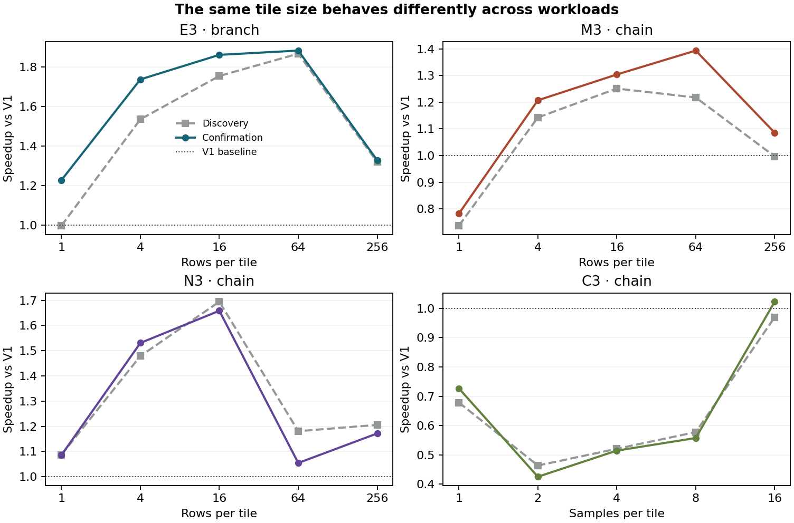
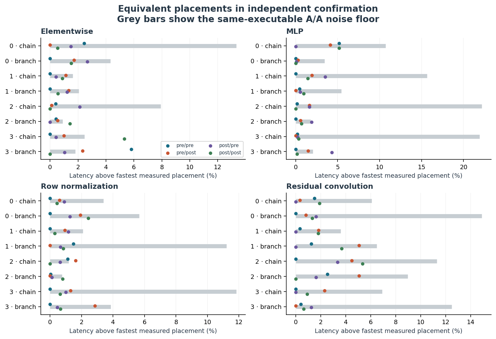

# FusionScope · XLA 激活观测、算子融合与执行开销

推理程序每次都要返回主输出和两层 ReLU 的精确正激活数。第一阶段移动计数的位置，第二阶段保持观测位置固定，改变归约、共享激活和分块的方式，再检验能否用原程序的 IR 选出更快的方案。

**[两阶段英文论文（PDF）](output/pdf/FusionScope.pdf)** · [独立可编译的 LaTeX 源文件](paper/FusionScope.tex) · [第三阶段实验计划（英文）](docs/plans/FusionScope_Phase3_Research_Plan.md)

论文用冻结的预测和特征表逐项检验了模型排序。联合归约在全部 186 次比较的五项估计成本上都不高于对手，其中归约层数严格更少。第三阶段计划据此比较新的成本特征、仅试两个候选的选择方法和各自的编译及试跑成本。[复核诊断的脚本](paper/check_diagnostics.py)

| 阶段 | 研究问题 | 报告与证据 |
|---|---|---|
| 一 · 观测位置 | ReLU 前后计数会改变融合边界和耗时吗？ | [中文报告](results/cpu/report/REPORT.md) · [九配置先导](results/cpu/pilot/first_report.md) · [独立复跑](results/reproducibility/README.md) |
| 二 · 重复计算与分块 | 两层的计数怎样共享计算，块大小改变什么？ | **[中文报告](results/phase2/report/REPORT.md)** · [五例 HLO 审计](results/phase2/analysis/PHASE0.md) · [七篇原始论文的依据](docs/phase2-literature.md) |

## 第二阶段结果

在单个逻辑 CPU 上完成 32 个合成条件的 250 个配置和两个官方 Flax ResNet 子图的 8 个配置。共 6,507 项输出校验通过。大逐元素分支的联合归约将两个跨融合体的 4 MiB 掩码消除，相对两次独立计数加速 **3.07×**。按 16 行分块加速 **1.86×**，在大卷积上每块 2 个样本却只达到原速度的 **0.43×**。两个 ResNet 子图中，联合归约相对独立计数的配对时间差都低于 A/A 波动阈值。[测量与判定规则](results/phase2/protocol.json) · [逐案结果](results/phase2/analysis/timings.csv)

在整图族留出的独立确认中，解析模型对 32 个合成条件全部选择了联合归约，与固定联合归约的选择损失中位数同为 **10.9%**。岭回归的该项损失为 **31.0%**。先在发现批实测各个块大小，再把最快的块用于确认批，有 **26/32** 个条件距最快合法方案在波动阈值内。这项对照需要额外的编译和测量预算。[测试前封存的推荐](results/phase2/model/prediction_lock.json) · [策略全表](results/phase2/model/policy_summary.csv)



从 GitHub 干净克隆后，另用 3 个新进程重跑五个筛选案例。43 个配置的优化后 HLO 指纹全部复现，387 项输出校验通过。大逐元素分支的联合归约再次加速 2.92×，大卷积每块 2 个样本再次降至 0.42×。[独立复跑逐项结果](results/phase2/screening/replay/comparison.csv)

## 第一阶段结果

在 Intel Core i5-13420H 上，逐元素、全连接、归一化与卷积四个图族共 32 个条件、288 个编译配置。对每个条件，四种双点位置都生成了相同的优化后 HLO 计算体。三个新进程的独立复测也未能为这 32 个条件的前两名稳定排序。增加计数本身有成本，128 个双点配置的延迟相对基线中位数为 **1.107×**。[配对时延](results/cpu/report/tables/latencies.csv) · [同一可执行文件的 A/A 波动](results/cpu/report/tables/noise.csv)

官方 Flax ResNet 的单块和相邻双块各保留了 **4 种** HLO，两个子图的时延排名仍在本次判据下无法分出。追加的编译对照把图和输入固定，在逐元素图和单个 ResNet 块上均观察到相同规律：直接使用 `jnp.maximum` 得到 1 类，使用 `jax.nn.relu` 得到 4 类。三组输入上的两个计数完全一致。[逐边证据](results/cpu/report/tables/structure.csv) · [ReLU 写法对照](results/cpu/lowering_aligned/comparison.csv)

IR 模型 M2 在未见图族上的选择损失中位数为 **0.956%**，固定在两处 ReLU 后观察为 **0.749%**。这批数据没有显示 IR 选址的稳定优势。用四个已测单点估算双点开销，绝对误差为 60.59 µs；32 个条件中的 16 个由于基线 HLO 定位歧义触发了 M2 的源码回退。[各策略与图族的完整比较](results/cpu/report/tables/policy_summary.csv)

从 GitHub 干净克隆后重跑整套实验，306 个正式及外测配置的 HLO 指纹全部复现，双点延迟倍率中位数为 **1.110×**。两次运行中，最大尺寸按行归一化图的 8 个双点配置均在发现与确认批次中呈现负交互，合算两个计数的增量低于分别测得的单点增量之和。两次各有 **75,640 条逐次计时**，原始读数可下载复核。[两次运行的逐项对照与完整归档](results/reproducibility/README.md)



## 在本机运行

论文源文件内含图表、数据点和参考文献，可单独上传 Overleaf，或用 pdfLaTeX 编译两次。在仓库根目录运行 `python paper/check_diagnostics.py` 可用 Python 标准库复核论文新增的模型比较和图中数据。

下面的命令在仓库根目录的 PowerShell 中执行。正式结果使用 Python 3.12.5、JAX/jaxlib 0.9.0.1 和 Flax 0.12.3。Windows 可使用完整依赖锁；其他支持 JAX 的平台可从 `requirements.txt` 安装。[测量环境](results/cpu/matrix/env_p0.json)

```powershell
py -3.12 -m venv .venv
.\.venv\Scripts\python.exe -m pip install -r requirements-windows-lock.txt
.\.venv\Scripts\python.exe run.py --stage verify
.\.venv\Scripts\python.exe -m fusionscope.phase2.experiment --stage verify
.\.venv\Scripts\python.exe run.py --stage recommend --case R2
```

最后一条命令读取未观测 R2 基线的特征和锁定的模型，列出四种候选、预测倍率、选择及回退原因。查询 `minimum_before_relu` 会被明确拒绝。自定义带有 `u_relu`、`v_relu` 标记的基线函数也可直接传给 `recommend_program`。[选择工具接口](docs/METHODS.md#对自己的基线调用选择工具)

从仓库根目录重做实验。第一阶段的先导与全量命令共用恢复点，两阶段分别写入自己的输出目录。

```powershell
.\.venv\Scripts\python.exe run.py --stage first --out reproduction/cpu
.\.venv\Scripts\python.exe run.py --stage all --backend cpu --out reproduction/cpu
.\.venv\Scripts\python.exe -m fusionscope.phase2.experiment --stage all --out reproduction/phase2
```

第一阶段入口依次为 `pilot`、`matrix`、`model`、`confirm`、`external`、`controls`、`lowering`、`report`、`verify`。第二阶段为 `audit`、`screen`、`matrix`、`model`、`confirm`、`external`、`report`、`verify`。第二阶段从仓库内已归档的第一阶段基线 HLO 开始，可以独立执行。计时进程按顺序启动，每次运行全程使用同一输出目录。`report` 和 `verify` 默认读取发布结果，运行新实验时使用新的 `--out`。两阶段的实测后端均为 CPU。

## 目录

| 位置 | 内容 |
|---|---|
| [docs](docs/) | 两阶段任务书、第一阶段方法和第二阶段论文笔记。[第二阶段原始计划](docs/plans/FusionScope_Phase2_Research_Plan.md) |
| [fusionscope](fusionscope/) | 共用图定义、计时和 HLO 解析。第二阶段的候选、成本模型及验证器在 [phase2](fusionscope/phase2/) |
| [results/cpu](results/cpu/) 与 [results/reproducibility](results/reproducibility/) | 第一阶段的正式实验与干净克隆复跑 |
| [results/phase2](results/phase2/) | `screening`、`matrix`、`confirmation`、`external` 按进程保存原始 ZIP。编译记录指向 [IR 归档](results/phase2/ir/)，[汇总表](results/phase2/analysis/)、[冻结模型](results/phase2/model/)、[图](results/phase2/figures/) 与 [完整性校验](results/phase2/report/audit.json) 分开存放 |
| [vendor](vendor/) | 固定版本的官方 Flax ResNet 实现与许可 |

本地新跑的数据写入 `reproduction/`，虚拟环境、缓存、原始附件副本和旧 Lab 工作目录由 Git 忽略。第一阶段报告引用的旧任务书保留原路径，历史 Lab 可从冻结提交获取。

## 从研究问题查数据

| 想核对的内容 | 入口 |
|---|---|
| 原始计划、Lab 01、具体实验决定 | [任务书原文](docs/FusionScope_Research_Plan_v2.md) · [历史 Lab 01](https://github.com/ZZzJunzum/Compiler_report/tree/f2df6a2/lab01) · [预登记](protocol.json) · [实验方法](docs/METHODS.md) |
| 每个配置的图、IR 和逐轮时间 | [配置索引](results/cpu/report/tables/configs.csv) · [发现批原始记录](results/cpu/matrix/raw/) · [独立复测原始记录](results/cpu/confirm/raw/) |
| 两次观测有没有共享开销 | [所有交互及噪声参考](results/cpu/report/tables/interactions.csv) · [逐进程计算](results/cpu/report/tables/process_interactions.csv) |
| 预测是否在测试前锁定、错在何处 | [已封存推荐](results/cpu/model/prediction_lock.json) · [逐案决策](results/cpu/report/tables/decisions.csv) · [成本与摊销](results/cpu/report/tables/costs.csv) |
| 外测、显式执行边界和语义验证 | [外部子图](results/cpu/external/) · [两次可执行程序对照](results/cpu/report/tables/boundaries.csv) · [完整性检查](results/cpu/report/audit.json) |
