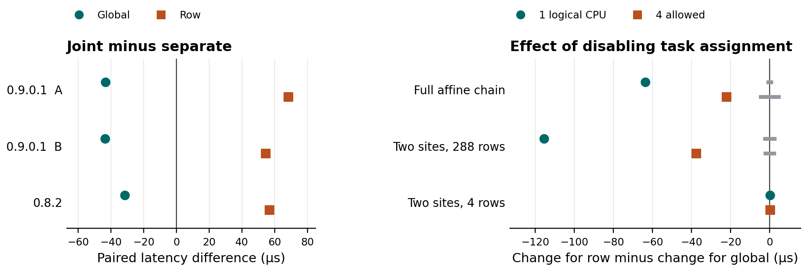

# 为什么同一条仿射链上的联合计数会反转？

下文记录最初的单核与四核发现阶段。默认亲和性、固定元素量的行数对照、两个局部改写和冻结后的独立验证已在[后续研究报告](../partition_boundary/README.md)中分别给出。不同日期的正式状态见[逐会话表](analysis/sessions.md)。

在一台 i5-13420H 上，固定两处激活并使用同样的输入和权重，联合计算两个全局计数更快，改为返回每行的计数就更慢。生成代码揭示了 XLA 的一个具体选择。它可以沿着行向量的输出维度给联合计数循环分派任务。主图的每行计数循环被划为 12 份，全局计数循环没有外层分区。在固定宽度的简化程序里，仅改变这一个计数内核就重现了额外耗时。

这里的具体数字来自 **2026 年 11 月 20 日** 的发现实验。跨日期是否复现，以记录真实采样日期的逐会话表为准。数据支持一个可干预的 CPU 编译案例。面向新模型的自动选择收益仍待检验。[最新逐会话表](analysis/sessions.md) · [研究设计](../../docs/plans/Observation_Mechanism_Research_Plan.md) · [计时前冻结的干预与预测](../../docs/plans/axis_probe_execution.json)



## 同样的两个观测点

下表使用微秒。负数表示联合更快。每个进程先对三份实际输入等权，再对五个进程取中位数。交互量在进程内配对计算，表中两列中位数直接相减可能得到不同数值。两个 0.9.0.1 会话均在同一天独立启动。

| JAX/jaxlib 与会话 | 全局的联合减独立 | 末轴的联合减独立 | 两种请求的交互 | 交互 A/A 门槛 |
|---|---:|---:|---:|---:|
| 0.9.0.1，A | −43.32 | +68.37 | +115.80 | 13.86 |
| 0.9.0.1，B | −43.67 | +54.45 | +110.03 | 22.18 |
| 0.8.2 | −31.65 | +56.80 | +88.45 | 14.10 |

另外五张旧图用来辨别解释。两次主版本会话中，小仿射链和同形状仿射分支均有正向轴交互，超过各自门槛。dense 和 gated 两图的末轴联合计数均有收益。没有目标导出的卷积对照，两次末轴差值都落在波动门槛内。每次调用在所有输出就绪时停止计时。[六图原始对照](analysis/contrasts.csv) · [第二版本](jax082/analysis/contrasts.csv) · [逐输入效应](analysis/seed_effects.csv)

## 哪个编译步骤改变了执行结构

在主仿射链上，独立计数在树归约改写后产生窗口。全局版本的窗口为 32×32，末轴为 1×32。联合计数跳过了这两个标量计数的窗口划分，两份完整掩码的导出消失。末轴独立版本的计划临时空间是 416,000 字节，联合版本是 16 字节。两个联合版本的比较指令都是 8 路 FP32 向量，且都有整数向量求和。简单的“末轴程序丢失了向量化”解释与编译产物不符。[各图结构](analysis/structure.csv) · [LLVM 指令索引](analysis/llvm_kernels.csv)

目标 XLA 版本的任务分配器会查看元组第一个输出的形状，按可用输出维度决定分区。总成本判定也参与选择。主图的生成代码显示，两种联合程序的主输出内核都划为 12 份。只有返回行向量的计数内核也被划为 12 份。该数字描述编译器划出的工作份数。进程允许使用的逻辑 CPU 由操作系统亲和性单独记录。[JAX 发行版的 XLA 修订](https://github.com/jax-ml/jax/blob/470cf68044b59afde006e541731ea75c32e2a302/third_party/xla/revision.bzl) · [分区实现](https://github.com/openxla/xla/blob/bb760b047bdbfeff962f0366ad5cc782c98657e0/xla/service/cpu/parallel_task_assignment.cc#L245-L271) · [主图的 pass 前后 HLO、缓冲区和 LLVM](ir/cpu1/t_E1_chain)

我们只关闭 `cpu-parallel-task-assigner`，在相同输入块中交错测量开、关两个可执行文件。下表的 K 为“关闭后末轴联合的耗时变化，减去关闭后全局联合的耗时变化”。每格为 **K / 对应的 A/A 门槛**，单位微秒。

| 程序 | 0.9.0.1，允许 1 个逻辑 CPU | 0.9.0.1，允许 4 个 | 0.8.2，允许 1 个 |
|---|---:|---:|---:|
| 完整 320×160 仿射链 | −63.62 / 1.69 | −22.20 / 5.52 | −64.03 / 2.36 |
| 两个仿射点，288×160 | −115.45 / 3.38 | −37.67 / 3.14 | −67.88 / 1.04 |
| 两个仿射点，4×160 | +0.17 / 0.76 | +0.15 / 0.33 | +1.03 / 1.10 |

完整图的主输出内核也随开关而变，不能将整次调用的加速全部归给计数。简化程序直接返回原输入，仅计算两个观测点。在大尺寸上，切换开关时，末轴联合程序唯一的计数内核目标文件发生变化，全局联合程序的目标文件逐字节相同。小尺寸的两个内核均逐字节相同，大、小尺寸的性能方向也符合计时前的预测。该干预定位到已分区的计数代码路径，尚无逐内核动态数据能拆出调度、同步与循环代码各占多少时间。[简化程序的编译产物](ir/cpu1/two_sites_large) · [小尺寸对照](ir/cpu1/two_sites_small) · [每个可执行文件的耗时](analysis/latencies.csv)

## 训练过的网络和精确计数的边界

用官方 MNIST 训练划分中的 20,000 张真实手写数字训练四隐藏层分类器，官方测试集准确率为 **96.06%（9,606/10,000）**。固定最终权重，取三个相邻层片段，在前三个不重叠的 64 图测试批次上计时。三个片段的末轴联合计数分别节省 **3.27、2.80、2.70 微秒**，都超过对应门槛。225 项整段输出检查全部通过。三个片段来自同一网络且共享部分层，研究规模是一个训练好的模型、192 张计时图像。[权重与训练记录](mnist/training.json) · [三个片段的结果](mnist/contrasts.csv) · [完整网络激活核对](mnist/checks.csv) · [MNIST 来源](https://keras.io/api/datasets/mnist/)

这些真实批次的被测激活离零最近约 3.53×10⁻⁵，没有落入绝对值 10⁻⁵ 以内。我们另测了正负零、正常数、抵消输入、紧邻零的非正规数和非有限值。两个版本中，固定数组的每个统计点各含两个最小正 FP32 非正规数。NumPy 参考计数为 2，两种编译写法都返回了 0。有限正常输入上的整图校验、S/J 对同一个整数掩码的等价性、对任意 FP32 输入满足严格谓词，是三个强度不同的主张。数据只支持已验证的范围。[零邻域原始位模式与逐项结果](analysis/fixed_sites.json) · [版本复查](jax082/analysis/fixed_sites.json)

## 编译成本怎样改变选择

若在部署前已决定使用哪种实现，实测固定策略总成本为一次构建加上 N 次调用，选择成本为零。主图末轴联合的单次调用较慢，但构建较快。两次原版本会话中，相对直接编译独立归约，执行 100 次时联合的总成本仍低 **27.34 / 36.78 毫秒**。执行 1,000 次时反而多 **27.53 / 12.48 毫秒**。这里按进程先合计再取中位数，构建为已启动运行时内的 lowering 与编译，含随机化构建次序的影响。已有可执行文件可复用时，只需计新增成本。若还需编译候选、读取 HLO 或试跑，其额外费用须另计。实验没有测得通用自动选择器的净收益。[N=1、100、1,000、10,000 的逐图账目](analysis/fixed_costs.csv)

## 复现

从仓库根目录执行以下命令。归档重算读取已有文件，重新计时默认写入独立的 `reproduction/axis_probe`。基础环境见根目录的 Windows 依赖锁。第二版本将 JAX/jaxlib 同时换为 0.8.2，并保持 NumPy 2.3.5、SciPy 1.18.1、psutil 7.2.1。两个 XLA 二进制的 SHA-256 与实际亲和性均已保存。[主版本环境](ir/cpu1/environment.json) · [四个逻辑 CPU](ir/cpu4/environment.json) · [第二版本环境](jax082/ir/cpu1/environment.json)

```text
python -B -m fusionscope.axis_probe.analysis verify
python -B -m fusionscope.axis_probe.analysis verify --out results/axis_probe/jax082
python -B -m fusionscope.axis_probe.mnist verify --out results/axis_probe/mnist
python -B -m paper.check_axis_results
python -B -m fusionscope.axis_probe.collect capture
python -B -m fusionscope.axis_probe.collect session --panel axis --name day1
python -B -m fusionscope.axis_probe.collect session --panel task --name task1
python -B -m fusionscope.axis_probe.analysis report --out reproduction/axis_probe
```

换日期时保留同一输出目录并换用新的会话名。四逻辑 CPU 复查在 capture 和 task session 命令上都加 `--cpus 4`。重跑 MNIST 时先用 `python -B -m fusionscope.axis_probe.mnist train`，再运行同一模块的 `measure` 和 `report`。也可将归档的 `model.npz` 和 `training.json` 复制到新目录并用 `--out` 指定，从已封存的权重开始测量。
