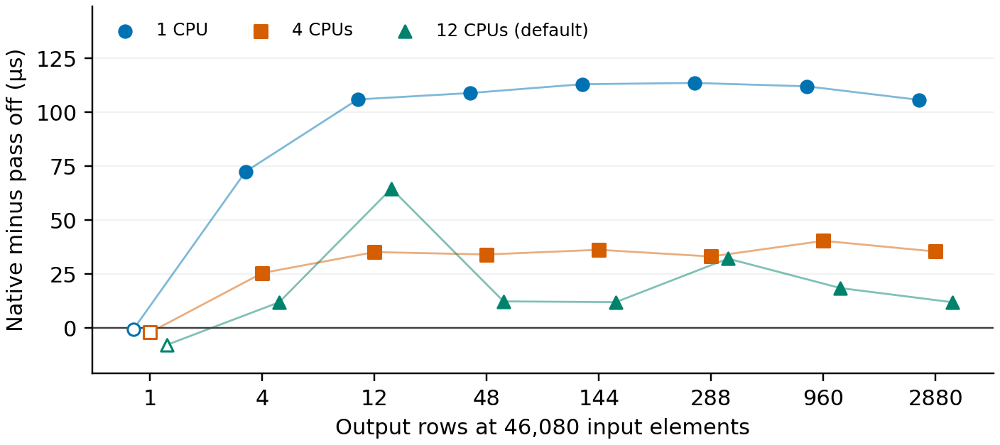

# 哪些逐行计数值得分区？

在同一台 i5-13420H 上，我们观察到两个可以分别检验的现象。完整仿射链上，逐行联合计数相对独立计数的减速在开放全部 12 个逻辑 CPU 后反转。只保留计数工作的简化程序上，即使开放全部 CPU，较小的计数内核仍会因分区变慢，工作量增大后同一分区又能节省时间。我们做了两种局部改写，并在留出程序上计入选择、构建和调用成本。两种冻结规则均未达到方法贡献的预设门槛。[论文 PDF](../../output/pdf/FusionScope.pdf) · [开发实验预登记](../../docs/plans/partition_boundary.json) · [局部分区实验预登记](../../docs/plans/scoped_assignment.json)

## 前人工作与研究问题

AutoNumerics-Zero 的 2023 年版本在 §2.2 与 §S3 解释了单线程评估中，XLA 的 CPU Parallel Task Assigner 会给长融合引入分派开销。其演化出的程序把计算拆为两个短融合，避开了这条路径。TapirXLA 此前已探索 XLA 的多核并行表示与优化。本研究固定两个计数的来源，沿着输出形状追到被改变的目标文件，再通过默认亲和性、大工作量和真实下游输出检验机制的适用范围。[AutoNumerics-Zero §S3](https://arxiv.org/html/2312.08472v1#S3) · [TapirXLA](https://arxiv.org/abs/1908.11338) · [固定版本的 XLA 分区实现](https://github.com/openxla/xla/blob/bb760b047bdbfeff962f0366ad5cc782c98657e0/xla/service/cpu/parallel_task_assignment.cc#L245-L271)

## 亲和性和归约形状分别改变什么

下表单位为微秒。第一列效应是完整仿射链的逐行联合减独立。后两列是只返回输入与计数的程序中，同一逐行联合实现保留任务分配减去关闭任务分配。每格给出配对差值和对应 A/A 门槛，正值表示左边的实现更慢。

| 允许使用的逻辑 CPU | 完整链，逐行联合减独立 | 288×160，保留减关闭分区 | 1536×1024，保留减关闭分区 |
|---|---:|---:|---:|
| 1 | +74.47 / 3.47 | +113.60 / 7.23 | +92.28 / 88.96 |
| 4 | +7.18 / 8.38 | +33.18 / 4.46 | −182.02 / 67.74 |
| 默认 12 | −23.73 / 6.65 | +32.20 / 6.50 | −852.63 / 153.35 |

在同一 46,080 元素简化程序上，分别使用 1、4、12、48、144、288、960、2,880 个输出行。机器码对应的 HLO 在第一种形状无外层分区，第二种分成 4 份，其余六种分成 12 份。默认亲和性下，七个触发了分区的形状，其保留分区的额外延迟均超过相应门槛。相同的 12 份划分既可使 288×160 变慢，也可使 1536×1024 变快。完整图的主输出内核也受全局开关影响，隔离到计数内核的结论来自简化例。[配对结果](discovery/analysis/pairs.csv) · [轴和开关的匹配交互量](discovery/analysis/interactions.csv) · [编译结构、缓冲与对象](discovery/analysis/kernels.csv)



三个亲和配置下，11 张发现图的 8 个变体共 88 组编译产物，其对象摘要、调度和临时空间在各配置间一致。默认亲和性保持原 OS 掩码。独立的半秒调用循环中，288×160 的原生和关闭分区版本，进程各线程 CPU 时间之和除以墙钟时间分别为 2.19 和 1.75；1536×1024 分别为 2.65 和 1.91。这是整个进程的平均 CPU 占用，受 Windows 线程计时分辨率影响。12 个任务与同时运行的线程数是两个量。相同编译代码的耗时会随可用资源而变。[实际亲和性及逐线程原始计数](discovery/default_profile.json) · [三种配置的对照](discovery/analysis/profiles.csv)

## 两种局部改写及其对照

**整数打包计数。** 对宽度为 W 的一行，令 b 为 W 的二进制位数。把两个正值谓词 p、q 编为 p + 2ᵇq，以 uint32 求和后在低 b 位和高位取回两个 int32 计数。检查 W > 0、形状相同且 W + W×2ᵇ ≤ 2³²−1。宽度 65,535 的双计数饱和值能正确还原，65,536 和零宽被拒绝。此保证条件于相同的谓词值。对含两个最小正 FP32 次正规数的固定行，主机 IEEE 参考给出 2，原生与打包均给出 0。[实现](../../fusionscope/partition/workloads.py) · [边界实测](contract.json)

**局部调整任务分配。** 单独编译普通主程序和只计算两个观测量的子程序。主程序沿用原生 XLA，只在观测子程序中关闭任务分配。另做两份子程序都沿用原生编译的对照。返回输入本身的程序可直接复用不可变输入数组，其他程序都要构建并调用主程序，且可能重算激活。八张留出图的主程序对象文件均与原始主程序逐字节相同。[实现](../../fusionscope/partition/scoped.py) · [八张图的对象对照](../scoped_assignment/holdout/analysis/scoping.csv)

这个对照揭示了反方向的效应。在默认亲和性的 1536×1024 简化程序中，拆开并关闭观测分区比原始整图快 273.30 微秒；但与**同样拆开且保留观测分区**的版本比较，关闭分区慢 546.63 微秒。原始整图的优化后 HLO 有一份 6 MiB 的主输出复制，拆开后可以直接返回已有输入。不能据此把 273.30 微秒归功于关闭并行。若应用要求独立可写的输出缓冲，直接返回输入的合同也需要调整。[原始整图 HLO 与对象](discovery/default_ir.zip) · [三方计时](../scoped_assignment/discovery/analysis/pairs.csv)

## 冻结后，规则在新程序上怎样

四种留出结构为残差平方、两路独立输入、门控乘积和逐行中心化残差。各有 96×192 和 1024×768 两个形状，分别测 1、4 和默认 12 个逻辑 CPU。共四种结构、八个实例、24 个条件。发现程序中十个实例的主输出是输入本身，所有留出结构都计算真实下游输出。两轮使用同一组留出结构、不同的新进程。每轮开发时，原生联合、原生独立和该轮的局部改写对资源规则、简单粒度规则以及形状规则均可用。冻结标准要求 N=1,000 时总成本比最强简单规则至少低 5%，所有选中结果通过输出检查且默认亲和性下无可分辨的延迟退化。[打包规则冻结提交](https://github.com/ZZzJunzum/Compiler_report/commit/19238ac) · [局部规则冻结提交](https://github.com/ZZzJunzum/Compiler_report/commit/79112c3)

- 打包菜单中的形状规则在所有条件选择原生联合计数。相对固定原生联合，1,000 次调用的几何平均总成本比为 1.000057。直接固定打包的相应比值为 1.350；运行期打包相对原生联合有 6 个条件加速、13 个减速、5 个未分辨。[判定](holdout/analysis/verdict.json) · [逐组计时](holdout/analysis/pairs.csv) · [强基线](holdout/analysis/cost_ratios.csv)
- 局部分区菜单的形状规则在开发集 33 个条件始终选择拆开并关闭观测分区。开发总成本比为 0.673。原样用到留出程序时，单次调用比原生联合快 8 组、慢 11 组、5 组未分辨。该轮原生联合比独立计数慢的 3 组中挽回 2 组，同时伤及原生联合本来占优的 20 组中的 10 组。整图保留分区优于全局关闭的 8 组中，选用局部方案后有 7 组相对原生更慢。默认亲和性下出现 5 个可分辨的退化。[逐组选择与对照](../scoped_assignment/holdout/analysis/policy_effects.csv) · [冻结判定](../scoped_assignment/holdout/analysis/verdict.json)
- 两种方案选中的 24 组都通过正确性检查。两个实验从开发到留出合计 11,115 项输入、变体、进程与资源组合检查，全部通过。先冻结初始规则，随后在接触留出程序前另外登记并冻结局部编译实验。两轮的终点各自保留。A/A 经验 95 分位数用来筛查本次测量的重复性，六个别名差异共享可执行文件及部分中位数。每个条件的三个输入、五个进程和十二个计时轮次均保留于归档。[打包的全部留出检查](holdout/analysis/validity.csv) · [局部编译的全部留出检查](../scoped_assignment/holdout/analysis/validity.csv)

## 部署净成本与使用范围

以固定原生联合作为 1.000。每个条件先对五个进程的配对成本比取中位数，再对 24 个条件取几何平均。每次只收所选实现的构建、实际查询资源与决定实现的耗时，以及 N 次普通调用。已有可复用的主程序可执行文件时，仅扣除它的实测构建费。单有 HLO 文本时仍需支付构建费用。

| 局部拆分并关闭观测分区 | 1 次 | 100 次 | 1,000 次 | 10,000 次 |
|---|---:|---:|---:|---:|
| 从头构建 | 1.348 | 1.285 | 1.171 | 1.083 |
| 已有可复用的主程序 | 0.689 | 0.862 | 0.995 | 1.053 |

从头构建时，这批留出程序在四个预算上均以固定原生联合的总体成本最低。已有主程序且只调用一次时，拆分方案在 24 个条件的配对中位成本都较低。执行次数增加后应看具体程序。96×192 的双输入例在单 CPU 冷构建下，五个进程分别从第 116 至 236 次之间开始回本；默认亲和性下五组均无回本点。逐行中心化残差在 N=1,000 的冷构建总成本比为 1.510，是四种结构中最差的一组。论文据此报告一个有边界的机制案例，并保留未通过的方法验证。[每个进程的选择、构建和调用费用](../scoped_assignment/holdout/analysis/charges.csv) · [汇总](deployment/budgets.csv) · [分组绝对毫秒差](deployment/cells.csv) · [逐进程回本区间](deployment/break_even.csv)

## 跨版本与跨日证据

2026 年 11 月 21 日重新启动 10 个单 CPU 进程，按原协议收集 65,520 次调用。完整主链的全局联合减独立为 −161.50 微秒，逐行为 +186.60 微秒。二者的进程内配对交互为 +348.10 微秒，超过当天 72.95 微秒的重复性门槛。首日两批分别为 +115.80 和 +110.03 微秒。两天均重现方向，第二天的效应和门槛都更大。[逐会话结果](../axis_probe/analysis/sessions.md) · [真实日期、样本与检查状态](../axis_probe/analysis/status.json)

| 关闭分区的逐行效应减全局效应，微秒 | 11 月 20 日，效应 / 门槛 | 11 月 21 日，效应 / 门槛 |
|---|---:|---:|
| 320×160 完整链 | −63.62 / 1.69 | −315.23 / 65.19 |
| 288×160 简化大例 | −115.45 / 3.38 | −279.72 / 41.51 |
| 4×160 简化小例 | +0.17 / 0.76 | −8.68 / 19.49 |

完整图和大简化例两天均重现负向干预，小负对照两天均落在门槛内。新日期的 1,400 项整图输出检查全部通过。另做的 120 项固定激活比较中，40 项最小次正规数检查再次偏离主机 IEEE 参考。当天复验覆盖单 CPU 的原始六图与三个干预对照。默认亲和性、固定元素数和四种留出结构的两套策略仍只有 11 月 20 日的数据。原始干预另有同机 0.8.2 版本，真实网络证据来自一个训练过的 MNIST 模型的三个重叠片段。[11 月 21 日轴实验原始记录](../axis_probe/sessions/axis_20261121) · [同时期干预原始记录](../axis_probe/sessions/task_20261121_one) · [跨版本和 MNIST 证据](../axis_probe/README.md)

## 复现

从仓库根目录使用锁定的 Windows Python 环境。下列命令从已发布归档复算，不需要重新计时。

```text
python -B -m fusionscope.partition.fit --verify
python -B -m fusionscope.partition.scoped_analysis check-freeze
python -B -m fusionscope.partition.analysis verify --phase discovery
python -B -m fusionscope.partition.analysis verify --phase holdout
python -B -m fusionscope.partition.scoped_analysis verify --phase discovery
python -B -m fusionscope.partition.scoped_analysis verify --phase holdout
python -B -m fusionscope.partition.deployment --verify
python -B -m paper.partition_evidence verify
python -B -m paper.partition_dates --verify
python -B -m paper.check_partition_contract --verify
python -B -m paper.check_partition_results
python -B -m paper.check_axis_results
```

重新测量时使用空的输出目录，两个实验并列放在同一父目录，名称分别为 `partition_boundary` 和 `scoped_assignment`。资源设置依次运行。以下 PowerShell 命令使用当前已冻结的规则。

```powershell
foreach ($phaseName in 'discovery','holdout') {
    foreach ($studyName in 'partition_boundary','scoped_assignment') {
        $moduleName = if ($studyName -eq 'partition_boundary') { 'fusionscope.partition.collect' } else { 'fusionscope.partition.scoped' }
        $destination = "reproduction/$studyName"
        foreach ($cpuSet in 'one','four','default') {
            python -B -m $moduleName measure --phase $phaseName --resource $cpuSet --out $destination
            if ($LASTEXITCODE -ne 0) { throw 'Timing failed' }
        }
        python -B -m $moduleName capture --phase $phaseName --out $destination
        if ($LASTEXITCODE -ne 0) { throw 'Compiler capture failed' }
        if ($phaseName -eq 'discovery' -and $studyName -eq 'partition_boundary') {
            foreach ($cpuSet in 'one','four') {
                python -B -m $moduleName capture --resource $cpuSet --out $destination
                if ($LASTEXITCODE -ne 0) { throw 'Compiler capture failed' }
            }
            foreach ($cpuSet in 'one','four','default') {
                python -B -m $moduleName profile --resource $cpuSet --out $destination
                if ($LASTEXITCODE -ne 0) { throw 'CPU profile failed' }
            }
        }
    }
    python -B -m fusionscope.partition.analysis report --phase $phaseName --out reproduction/partition_boundary
    python -B -m fusionscope.partition.scoped_analysis report --phase $phaseName --out reproduction/scoped_assignment
}
```
