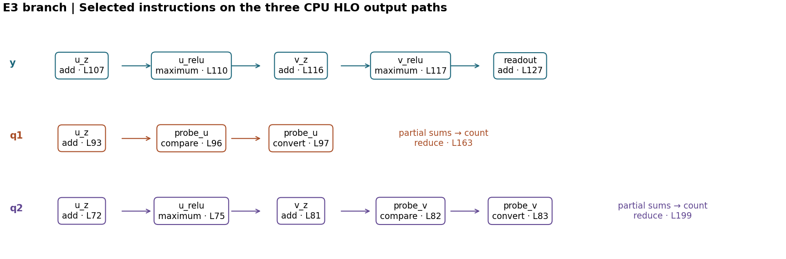

# 第一阶段 HLO 复核：正数计数在哪里重复了计算

审计取自冻结提交 `f2df6a2` 的 CPU 主矩阵。每案分别分析只返回 y 和返回 (y,q₁,q₂) 的 post/post 版本。从 ENTRY 的每个返回值回溯调用，将融合体形参绑定到调用处的实际操作数；两条路径引用同一条指令只计一次。判断复制时还核对源作用域、算子、类型布局、常量、属性和递归操作数签名。下表的副本数是已标记主干算术表达式跨不同 HLO 调用组多出的份数，保守计数会漏掉同义改写。[逐指令路径](fusion_paths.csv) · [表达式与行号](duplicated_ops.csv)

| 条件 | 仅 y 的额外副本 | 加两处计数后的额外副本 | 导出为 s32 的计数掩码字节 |
|---|---:|---:|---:|
| E0_chain | 0 | 7 | 32,768 |
| E3_branch | 0 | 7 | 8,388,608 |
| M3_chain | 0 | 2 | 524,288 |
| N3_chain | 4 | 14 | 2,097,152 |
| C3_chain | 0 | 3 | 0 |

## E3_branch 的三条路径

第一层的乘法在第 69、90、104 行，加法在第 72、93、107 行，分别位于产生 q₂、q₁、y 的三个融合体。第一层 ReLU 及第二层的乘法、加法各有两份，第二层 ReLU 在主输出路径中保留一份。只把重复的浮点加、减、乘、除按输出元素计，得到 6,291,456 次额外标量操作的静态估计。编译器还能向量化或合并指令。[优化后 HLO](../../cpu/matrix/ir/E3_branch/post_post/optimized_hlo.txt)

第 83、97 行的两个融合体各导出一个 s32[4096,256]。q₁ 的归约经第 139、151、163 行，q₂ 经第 175、187、199 行；形状都是 [4096,256] → [128,8] → [4,1] → 标量。C3 的同形比较和转换留在各自的归约融合体内部，因此上表该列为 0。[归约各级输入输出](reduction_structure.csv) · [导出值及逻辑尺寸](intermediate_bytes.csv)

## 后端证据与待验证问题

在相同 CPU 设置下重编译 E3，规范化 HLO 与冻结模块一致。缓冲区分配第 58–62 行将两块 4 MiB 的结果安排在同一临时区的 4,194,304 和 0 偏移，临时区总计 8,392,704 字节。两份优化后 LLVM 分别在第 62–63、82–83 行含向量 int32 存储。这支持“生成代码确实向缓冲区写掩码”。其缓存命中率、DRAM 字节和各条指令对延迟的贡献仍需单独的硬件测量。[缓冲区分配](../ir/diagnostic/E3_branch/cpu_after_optimizations-buffer-assignment.txt) · [q₁ LLVM](../ir/diagnostic/E3_branch/compare_convert_fusion.1_kernel_module.ir-with-opt.ll) · [q₂ LLVM](../ir/diagnostic/E3_branch/compare_convert_fusion_kernel_module.ir-with-opt.ll)

后续比较联合归约、显式传递第一层激活、按行生成局部计数三种安排。计时前能提出的假设是缩小或消除全尺寸掩码可能降低开销；同时分段调用、循环和较小的矩阵乘法也可能抵消收益。
