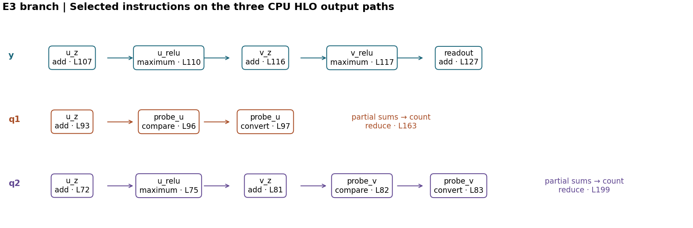
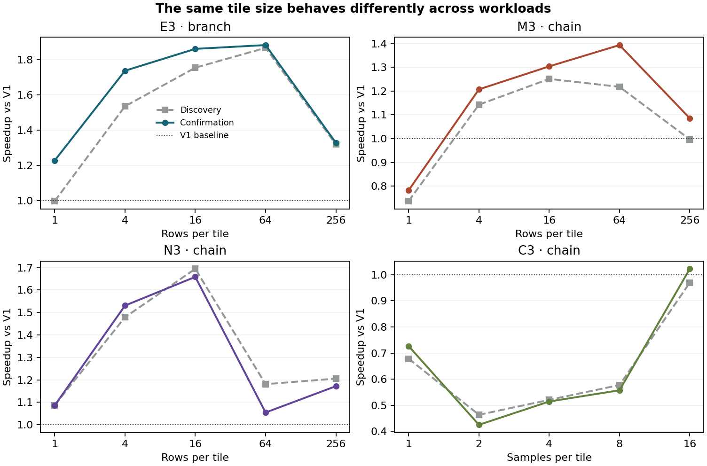
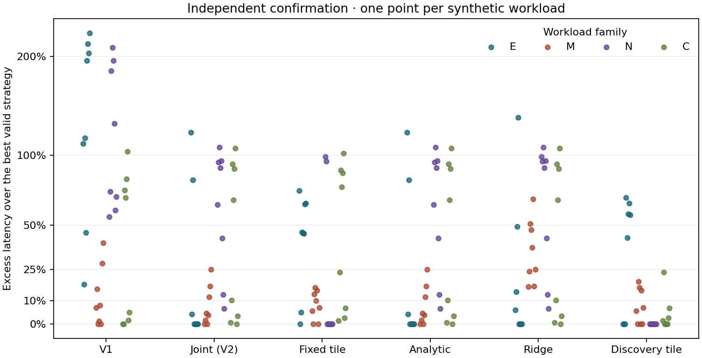

# 降低 XLA 激活观测开销：两处精确计数的执行代价

在同一段推理程序中，除主输出 y 外，每次还要返回两层 ReLU 的正激活数 q₁、q₂。第一阶段只改变计数在 ReLU 前还是后，32 个合成条件各自的四种双点位置都生成了相同的优化后 HLO。第二阶段固定计数语义，改变两次归约、上游计算和中间张量的组织。实验在 Intel Core i5-13420H 上运行，每个进程绑定单个逻辑 CPU。[第一阶段报告](../../cpu/report/REPORT.md) · [第二阶段预登记](../protocol.json)

大逐元素分支 E3 的两个独立计数原本各向缓冲区写一个 4 MiB 掩码。联合归约将这两块完整导出掩码降到 0，独立复测的加速为 **3.07×**。按 16 行分块也消除了完整导出掩码，却仍保留原来的 7 份额外算术，实测为 **1.86×**。在大卷积图 C3 上，每块 2 个样本的加速比为 **0.43×**。[逐配置数据](../analysis/timings.csv) · [优化后 HLO 结构和行号](../analysis/candidate_structure.csv)

## 1　相同输出如何产生不同程序

| 方案 | 输入相同，每次返回的内容 | 可核查的执行边界 |
|---|---|---|
| V0 无观测 | 只返回 y | 测主干延迟，计算观测增量时使用 |
| V1 独立计数 | y、q₁、q₂ | 两处 ReLU 后各比较、转换、求和，沿用第一阶段代码 |
| V2 联合归约 | y、q₁、q₂ | 两路 int32 掩码进入同一个多输入、多输出 reduce，逐分量相加 |
| V3 显式传递激活 | y、q₁、q₂ | 第一次调用输出第一层激活和 q₁，第二次消费该激活并输出 y 和 q₂ |
| V4 分块归约 | y、q₁、q₂ | 每块计算完整主干和两个局部计数，再拼接 y 并各自累加局部计数 |

逐元素 E、全连接 M 和按行归一化 N 都按完整行切分。卷积 C 只切 batch，保留每个样本的空间邻域。链式图只使用第二层读出，分支图将第一层激活再接回读出。官方 Flax ResNet 的单块 R1 和相邻双块 R2 都用 batch=1、固定随机权重和推理态 BatchNorm，观测第一块的第一次激活与最后一块的末次激活。两例只跑 V0 至 V3。[候选实现](../../../fusionscope/phase2/variants.py) · [形状、拓扑和权重](../../../protocol.json)

### 重复在哪里发生

从 E3 的 y、q₁、q₂ 三个返回值分别绑定融合体参数并回溯，定位到第一层同一加法在优化后 HLO 的第 72、93、107 行。第二层的生产者又出现在 q₂ 和 y 两处。V1 比仅返回 y 多出 7 份已标记的等价算术表达式。两棵归约树分别把 [4096,256] 压缩到 [128,8]、[4,1] 和标量。两个掩码在 CPU 的缓冲区分配表中同时占用不同偏移，两份优化后 LLVM 均有向量化 int32 存储。CPU 的实际快照还显示布局分配后的 fusion 前、fusion 后和 fusion-wrapper 后分别有 0、3、9 条 fusion 指令。[五个条件的审计](../analysis/PHASE0.md) · [CPU pass 快照索引](../ir/diagnostic/E3_branch/pipeline_steps.csv)

## 2　矩阵、正确性和计时

合成图有 4 类 × 4 档尺寸 × 2 种拓扑，共 32 条件、250 个含基线的配置，其中 122 个是各个合法块大小。ResNet 增加 8 个配置。筛选 5 案用 3 个新进程，完整发现用 5 个，锁定预测后的完整确认用 3 个，两个外测用 5 个。各批内部逐进程顺序运行，每个进程绑定一个逻辑 CPU，关闭持久化编译缓存。输入和权重预先就绪，编译与 lowering 单独计时。每个区块预热 6 轮、正式 20 轮，每轮随机交错同组候选，每次等所有设备输出就绪。V3 两次调用只在最终输出处同步。[分批原始包](../matrix/raw/) · [各进程耗时](../analysis/process_medians.csv)

每个进程用 42、1729、2026 三个种子核对输出。y 必须同形、有限、FP32 且满足第一阶段逐图族容差，q₁、q₂ 必须为标量 int32 并逐个等于独立返回激活后在宿主计算的整数。计时种子固定为 42。共 **6,507/6,507** 项配置 × 种子 × 进程校验通过。16 个进程合计记录 **43,380** 次正式候选调用（含 V0）、**44,960** 次正式 A/A 调用，另存 **26,502** 次预热。[正确性全表](../analysis/correctness.csv) · [原始确认记录](../confirmation/raw/) · [原始外测记录](../external/raw/)

另从 GitHub 干净克隆后重新编译并运行五个预先指定的筛选案例。43/43 个配置的优化后 HLO 指纹与首次筛选一致，另有 387/387 项输出校验通过。E3 分支的联合归约为 2.92×，C3 每块 2 个样本为 0.42×。这批计时独立于模型训练、选块和正式确认。[逐项复跑对照](../screening/replay/comparison.csv) · [干净克隆来源与原始包哈希](../screening/replay/provenance.json)

表中延迟是各进程中位数的中位数，加速比是同进程 V1/候选时间之比的中位数，超过 1 表示更快。对 V0 和 V1 各设四个标签调用相同可执行文件，分别取同一进程标签中位数差绝对值的第 95 百分位，再取两者较大值作为 A/A 波动阈值。在过半进程方向一致且配对时间差超过阈值时才判定改善或退化。噪声阈值是本机实测分辨率。Recovery 用配对节省时间除以配对的 V1−V0。只有后者超过阈值并且过半进程为正才报告。32 个确认条件中有 15 个满足该前提。[编译、执行、增量、Recovery 与波动](../analysis/timings.csv)

| 条件 | V0 µs | V1 µs | V2 加速 | V3 加速 | 发现批选块 → 确认加速 | A/A µs |
|---|---:|---:|---:|---:|---:|---:|
| E0_chain | 55.6 | 67.4 | 1.13× | 0.58× | 16 → 1.04× | 11.4 |
| E3_branch | 1,573.0 | 5,836.8 | 3.07× | 0.81× | 64 → 1.88× | 1,149.8 |
| M3_chain | 1,313.8 | 1,545.7 | 1.11× | 0.97× | 16 → 1.30× | 268.1 |
| N3_chain | 1,133.2 | 1,925.4 | 1.69× | 0.74× | 16 → 1.66× | 258.8 |
| C3_chain | 6,140.8 | 6,789.9 | 1.03× | 1.13× | 16 → 1.02× | 1,208.8 |
| R1 | 15,852.9 | 18,157.0 | 1.05× | 1.03× | 不适用 | 926.9 |
| R2 | 32,785.9 | 32,645.0 | 1.03× | 1.01× | 不适用 | 1,823.0 |

“发现批选块”只用发现批次选定每个条件最快的合法 V4，在独立批次测其加速。全部候选都保留。下表每个图族有八个条件，改善、退化、未分出均相对 V1。最后一列按确认中位数统计最快配置属于哪个策略，同一条件的微小差异应结合 A/A 判断。[逐案选择及与最快的差距](../model/heldout_results.csv)

| 图族 | V2 改善 / 退化 / 未分出 | 发现批选块改善 / 退化 / 未分出 | 实测最快 V1 / V2 / V3 / V4 |
|---|---:|---:|---:|
| E | 6 / 0 / 2 | 6 / 0 / 2 | 0 / 5 / 0 / 3 |
| M | 0 / 0 / 8 | 2 / 0 / 6 | 2 / 2 / 0 / 4 |
| N | 5 / 0 / 3 | 7 / 0 / 1 | 0 / 0 / 0 / 8 |
| C | 0 / 0 / 8 | 4 / 0 / 4 | 2 / 1 / 1 / 4 |

## 3　成功与退化案例

**E3，联合归约。** V1 与 V2 的跨融合体完整 int32 掩码从 8,388,608 字节降到 0 字节，V2 的双输出 reduce 位于第 117 行。两版已标记额外算术份数分别为 7、5，按形状展开的额外简单浮点运算估计从 6,291,456 变为 4,194,304。编译器给可执行文件规划的临时区从 8,392,704 字节变为 16 字节。V1 和 V2 的编译耗时中位数分别为 146.1 和 58.9 ms。V2 在确认批的成对节省为 3,747.3 µs，A/A 为 1,149.8 µs，Recovery 为 87.9%。[E3 全部方案 IR](../ir/E3_branch-4d21c48773c9a5ef.zip) · [逐部件内存](../analysis/compiler_memory.csv)

**E3，按行分块与显式物化。** 16 行版将 4,096 行分为 256 块，产生 512 个逻辑局部计数。HLO 的循环在第 356 行，每次循环体内导出的掩码合计 32,768 字节。每次处理的掩码缩小，按块数折算的重复简单浮点操作仍为 6,291,456。V3 明确输出一块 4 MiB 的 a₁ 并跨一次调用边界传递，前后两个可执行文件的临时区各为 4,198,400、4,198,400 字节。这一安排实测 0.81×，耗时相对 V1 增加 1,245.2 µs。临时区按单个可执行文件报告，进程生命周期峰值包括 JAX、编译器和同一进程的其他案例。[每个部件、形状与 HLO 行号](../analysis/candidate_structure.csv) · [逐进程发现批归档](../matrix/raw/)

**归一化与卷积。** N3 沿完整归一化行切分，确认批计时最低的合法块为 16 行，加速 1.66×。C3 的 V1 已将计数比较与归约放在同一融合体，跨融合体完整计数掩码为 0 字节。每块 2 个卷积样本会生成 8 块，实测 16,421.0 µs，耗时相对 V1 增加 9,677.1 µs。循环边界和每次卷积的 batch 尺寸都发生了变化，本实验测到两者共同作用后的时间。各测量进程的生命周期峰值工作集为 210–251 MiB。[C3 所有块大小的 IR](../ir/C3_chain-a5dccd89f149a3c1.zip) · [内存和时延的记录口径](../protocol.json)

对优化后完整模块去除名称和源码位置后，检查保留计算调度、类型、调用图及属性的指纹。与同一案例 V1 完全一致的其他单可执行文件候选共有 24 项，均为只有一个块的配置。过 A/A 阈值的有 1 项（E0_branch/V4_t16），其时间差无法归因于 HLO 结构变化。[可逐案筛选的指纹与等价标记](../analysis/candidate_structure.csv)

## 4　只看未观测 IR 能选对方案吗

每折留出一个完整图族，训练阶段看不到该图族的任一尺寸、拓扑或分块耗时。R1、R2 的模型只用四个合成图族训练。特征来自冻结的 V0 HLO、张量形状和声明的执行组织，覆盖主干/前缀算术量、两个 ReLU 的共享生产者、fanout、归约、预计掩码容量、激活物化、块数和两阶段调用。16/34 个基线条件至少有一个激活定位缺失或有多个候选。多候选取局部算术量最大的生产者切片，缺失时切片为空，同时保留歧义标志。候选优化后 IR 仅用于解释实测结果。[冻结特征](../model/features.csv) · [折划分与系数](../model/model.json)

解析模型以 µs 估算，形式为 调用成本 + max(计算成本, 搬运成本) + 归约层成本 + 块间循环成本，五个非负系数在训练折拟合。逻辑掩码容量用作搬运代理，分块能够复用缓冲区，但重复读写仍可能发生。岭回归对 log(候选延迟 / V0 延迟) 建模，特征只用训练折标准化，固定 α=1。比较候选时无需测试图的耗时。只在将相对预测换算为 µs 且计算误差时使用该进程实测 V0。两个模型的推荐在确认及外测前已封存。[封存选择及输入哈希](../model/prediction_lock.json) · [逐候选预测](../model/predictions.csv)

选择损失 = (所选时间 − 有效候选最低时间) / 最低时间。MAE 先在同一条件、候选的各进程取绝对预测误差中位数，再对有效候选等权平均。固定分块取不超过 16 的最大合法块，两个单样本 ResNet 回退到 V1。发现批选块需要预先编译并测量每个 tile，是有测量预算的对照。下表中的实测最快使用测试数据，只作比较上界。表中“噪声内”使用所选与最快两列跨进程中位数之差，前文判断相对 V1 的改善使用同一进程差值的中位数。[预测误差含对数误差](../model/prediction_errors.csv) · [完整策略统计](../model/policy_summary.csv)

| 组别 | 策略 | 有效条件 | 选择损失中位数 | P90 | 中位差 µs | 噪声内 | 命中最快 | MAE µs |
|---|---|---:|---:|---:|---:|---:|---:|---:|
| synthetic | 固定 V1 | 32/32 | 63.9% | 203.2% | 206.8 | 11 | 4 | — |
| synthetic | 固定 V2 | 32/32 | 10.9% | 95.4% | 64.2 | 19 | 8 | — |
| synthetic | 固定分块 | 32/32 | 11.5% | 87.9% | 36.0 | 20 | 9 | — |
| synthetic | 解析模型 | 32/32 | 10.9% | 95.4% | 64.2 | 19 | 8 | 1,336.3 |
| synthetic | 岭回归 | 32/32 | 31.0% | 98.4% | 74.2 | 13 | 5 | 691.6 |
| synthetic | 发现批选块 | 32/32 | 0.0% | 55.1% | 0.0 | 26 | 18 | — |
| synthetic | 实测最快 | 32/32 | 0.0% | 0.0% | 0.0 | 32 | 32 | — |
| external | 固定 V1 | 2/2 | 4.5% | 6.0% | 971.6 | 1 | 0 | — |
| external | 固定 V2 | 2/2 | 0.0% | 0.0% | 0.0 | 2 | 2 | — |
| external | 固定分块 | 2/2 | 4.5% | 6.0% | 971.6 | 1 | 0 | — |
| external | 解析模型 | 2/2 | 0.0% | 0.0% | 0.0 | 2 | 2 | 1,603.6 |
| external | 岭回归 | 2/2 | 0.0% | 0.0% | 0.0 | 2 | 2 | 6,062.2 |
| external | 实测最快 | 2/2 | 0.0% | 0.0% | 0.0 | 2 | 2 | — |

| 组别 | 策略 | 有效条件 | 选择损失中位数 | P90 | 中位差 µs | 噪声内 | 命中最快 | MAE µs |
|---|---|---:|---:|---:|---:|---:|---:|---:|
| E | 解析模型 | 8/8 | 0.0% | 92.4% | 0.0 | 6 | 5 | 279.7 |
| E | 岭回归 | 8/8 | 2.9% | 74.4% | 1.9 | 6 | 4 | 445.4 |
| M | 解析模型 | 8/8 | 4.1% | 19.1% | 8.7 | 6 | 2 | 1,108.7 |
| M | 岭回归 | 8/8 | 31.0% | 55.6% | 91.7 | 1 | 0 | 120.5 |
| N | 解析模型 | 8/8 | 76.5% | 98.9% | 101.2 | 3 | 0 | 280.9 |
| N | 岭回归 | 8/8 | 92.5% | 101.1% | 101.2 | 2 | 0 | 218.5 |
| C | 解析模型 | 8/8 | 38.2% | 96.6% | 682.7 | 4 | 1 | 4,023.0 |
| C | 岭回归 | 8/8 | 38.2% | 96.6% | 682.7 | 4 | 1 | 2,120.2 |

解析模型在 32/32 个合成条件选了 V2，选择损失中位数为 10.9%，与固定 V2 的 10.9% 相同。其非负开销项总是偏向不物化完整掩码、只做一次联合归约的方案，未能刻画部分块大小带来的局部性收益。Li 等的 CPU 融合模型在不同插入位置分列每次切片容量、调用次数和累计访问量，这区分了本解析估计中混合的两个量。[oneDNN Graph Compiler 图 3](https://arxiv.org/pdf/2301.01333)

岭回归将合成候选的绝对时间 MAE 降至 691.6 µs，但实际选择损失中位数升至 31.0%。发现批实测选块在 26/32 个条件中距确认最快方案小于 A/A 阈值，代价是需要逐一测量这些配置。[逐候选误差](../model/prediction_errors.csv) · [方案选择](../model/policy_summary.csv)

岭回归最大的合成图选择损失在 E1_chain，推荐 V4_t1（138.1 µs），最快为 V2（59.1 µs），相差 133.4%。外测中，R1 选 V2，实测最快 V2，差 0.0 µs，R2 选 V2，实测最快 V2，差 0.0 µs。其中有 2/2 张子图的 V2 相对 V1 配对差异落在 A/A 波动范围内。外测只有两张 batch=1 子图，主要检验从合成图迁移到官方残差块时的误差。[独立测试逐案决策](../model/heldout_results.csv)

## 5　与已有研究的关系和适用范围

Spartan 通过改变采样周期降低 GPU 训练的稀疏度监测开销。本实验固定每次都返回两个精确计数，衡量一次完整观测的代价。Boehm 等在 SystemML 中分析多聚合共享输入与中间值物化的取舍，XTAT 则说明 XLA 多消费者融合可以复制生产者。这里的两个计数来自相互依赖的层，还必须保留主输出 y。三条实际路径、CPU 缓冲区分配和逐次配对计时为这一具体情形给出了可复核的证据。[Spartan 表 7](https://eprints.gla.ac.uk/240696/2/240696.pdf) · [SystemML 图 1、式 3 与图 9](https://www.vldb.org/pvldb/vol11/p1755-boehm.pdf) · [XTAT 图 2](https://mangpo.net/papers/xla-autotuning-pact2021.pdf)

Halide 的调度研究解释了计算粒度、局部性与重复工作的权衡。Dodović 等在 CUDA map-reduce 中直接比较了逐元素原子更新与块内汇总。这里通过保留每个合法 tile，实测了分块既能缩小临时掩码，也会在某些卷积上延长执行。Roofline 提供了计算与搬运时间取较大者的建模依据。本项目没有采集 DRAM 硬件计数器，无法从这些数据拆出带宽、缓存命中率和各项调度的独立因果贡献。JAX map 的一个循环体可以包含多项 CPU 操作，GPU 的融合 pass、kernel 时间线和多设备泛化均未测量。[Halide 图 2–3](https://users.cs.duke.edu/~lkw34/papers/halide-pldi2013.pdf) · [CUDA 对照 §4.4 表 5](https://www.mdpi.com/2079-9292/15/5/1034) · [Roofline 原文](https://www2.eecs.berkeley.edu/Pubs/TechRpts/2008/EECS-2008-134.html) · [论文逐篇笔记](../../../docs/phase2-literature.md)

复现命令、依赖和两阶段目录位于[项目首页](../../../README.md)。每个过程包都含环境、原始用时、正确性和编译记录。编译记录的 `ir_archive` 指向案例归档，其中 `V2/main`、`V3/front`、`V3/back` 等目录各有 StableHLO 和优化后 HLO。[筛选的结构依据](../screening/gate.json) · [全部案例 IR](../ir/)
